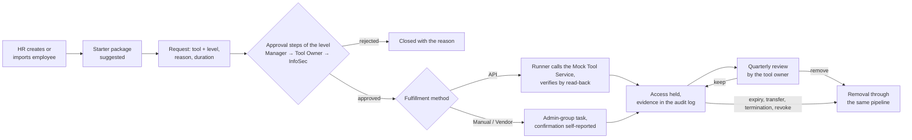
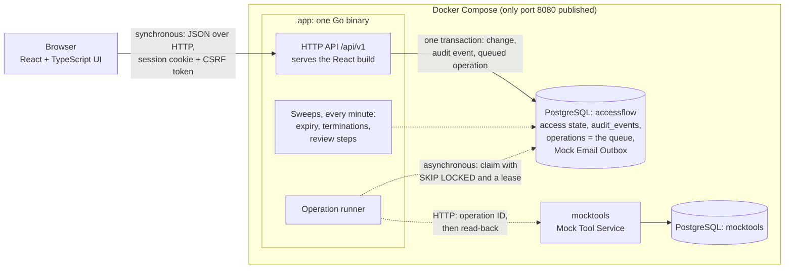

# AccessFlow

AccessFlow runs access to a company's internal tools from the request to its removal, with proof for the auditor.

The case ([`CASE.md`](CASE.md)): a regulated company of about 400 people and 60 tools grants access over chat. Nobody records who asked, who approved or why; admins hear about joiners, movers and leavers late; access is never removed (an audit found 14 leavers still holding accounts); and the quarterly access review the regulator asks for cannot be proven. In AccessFlow, every access is requested with a reason and a duration, approved by the right people, granted and removed through one tracked pipeline, reviewed every quarter by the tool owners, and recorded in an append-only audit log.

Go and PostgreSQL backend, React + TypeScript UI in Turkish. **Status:** all five areas of the case are implemented and tested. This is a local case-study build with simulated tools and e-mail, not a production deployment ([what is simulated](#api-manual-vendor-what-is-real-and-what-is-simulated)).

## Highlights

- **The right approvers, enforced on the server.** Each access level defines its steps (Manager, then optional Tool Owner and InfoSec). Nobody approves, fulfils or reviews their own access; a step whose approver is missing is re-routed, never skipped. Approval is always a human decision.
- **One fulfillment pipeline for three kinds of tools.** API tools are changed automatically and verified by reading the state back; Manual and Vendor tools get tracked tasks whose confirmations are labelled self-reported.
- **Provisioning that survives crashes and repeats.** The approval, the grant, its queued operation and their audit events commit in one transaction. The runner claims work with `FOR UPDATE SKIP LOCKED` under a lease, calls the tool with an idempotent operation ID and retries with backoff; failures land in Exceptions.
- **Joiners, movers and leavers.** A transfer pre-selects every grant for removal (keeping one needs a justification), a termination's removals run first, temporary access expires at midnight, and suspension is reversible.
- **Quarterly reviews that chase owners.** Each tool owner keeps or removes every grant: reminder on day 7, InfoSec escalation on day 14, an open security finding on day 21.
- **Proof that cannot be edited.** The audit log is written in the same transaction as each change; the app's database role can only insert and read it, and a trigger blocks updates and deletes. Point-in-time access shows who held what on any date and who approved it.
- **Tested against real PostgreSQL and measured at case scale:** 400 employees, 60 tools and 314,000 audit events ([numbers](#testing-and-performance)).

## Quick Start

Requirements: Docker with Compose v2 and a free port 8080. Nothing else; Go and Node run inside the images. The first build downloads images and modules and takes a few minutes.

```bash
docker compose up --build
```

Open **http://localhost:8080**. The API reference (Swagger UI) is at http://localhost:8080/swagger/ and the health check at `/api/v1/health`. If port 8080 is taken: `ACCESSFLOW_PORT=18080 docker compose up --build`. Stop with `docker compose down`; your data stays in the Docker volumes.

On the first start the database migrates itself and a demo company is created through the real services: 18 employees in 8 departments with a reporting hierarchy, 6 tools covering all three fulfillment methods, an Engineering starter package, and requests in every state, from approvals waiting at each step to a failed task, imported legacy access with orphan accounts, a suspended and a terminated employee, and a running quarterly review. The seed runs once; restarts keep every change you make ([details](docs/deployment.md#demo-mode)).

### Demo Accounts

**Local-demo-only credentials, set in `compose.yaml` (`DEMO_PASSWORDS`); unsuitable for production.** The sign-in page lists the accounts (a click fills the e-mail). Every page shows a "Demo Environment" badge.

| Persona | Email | Password | What to test |
|---|---|---|---|
| Super Admin | `admin@accessflow.local` | `Demo-Admin-2026` | Tools, levels and approval steps; roles and admin groups; the onboarding workbook; Exceptions; overrides and direct grants; the Mock Email Outbox |
| HR Manager | `ayse.demir@accessflow.local` | `Demo-HR-2026` | Create, transfer, suspend, terminate and rehire employees; the department and job-position catalog. Also owns Payroll Portal and sits in the Vendor Desk group |
| Engineering tools owner | `can.ozturk@accessflow.local` | `Demo-Owner-2026` | Owns Jira (API) and GitHub (Manual): Tool Owner approvals and their review items. IT Operations admin group: Manual tasks |
| Cloud tool owner | `emre.kaya@accessflow.local` | `Demo-Cloud-2026` | Owns AWS Console (API): review items for its grants. Also an InfoSec member (the second one the InfoSec fallback needs) and in IT Operations |
| Manager | `burak.sahin@accessflow.local` | `Demo-Manager-2026` | Manager approvals, the team's access, requests for and removals of reports' access, the team's audit events |
| Employee | `deniz.kara@accessflow.local` | `Demo-Employee-2026` | Request access with the starter package, follow it in My Requests, see My Access, give access up |
| InfoSec | `selin.aydin@accessflow.local` | `Demo-InfoSec-2026` | InfoSec approvals and reassignment, Exceptions (failed task, orphan accounts, findings), point-in-time access and the evidence reports |
| Auditor | `gizem.arslan@accessflow.local` | `Demo-Auditor-2026` | In Denetim kayıtları: read, filter and export the audit events as CSV, point-in-time access for any past date with its approvers, and approval evidence; the evidence reports, every other screen and every change are refused |

The other demo employees have no password; a Super Admin can send them an activation link through the Mock Email Outbox. Running without demo mode, configuration and recovery commands: [`docs/deployment.md`](docs/deployment.md).

## How It Works

HR creates (or imports) an employee → the department's starter package is suggested → the employee asks for a tool and level, with a reason and a duration → Manager, Tool Owner and InfoSec approve in order, as the level requires → the access is fulfilled by API, Manual or Vendor → the evidence is recorded → the tool owner reviews it every quarter → it is removed on expiry, transfer, termination, a review or a revoke, through the same pipeline.



### API, Manual, Vendor: what is real and what is simulated

| | What AccessFlow does | Evidence | Simulated |
|---|---|---|---|
| **API** | After the last approval, the operation runner calls the tool, then reads the account back; only the expected state counts. Retries, idempotency, operation tracking and audit are real application behaviour | *Verified* by read-back | The tool: a separate **Mock Tool Service** container with its own database, reached only over HTTP |
| **Manual** | A task in the tool's admin-group queue; an authorized member claims it, applies the change in the tool and confirms | *Self-reported*: who confirmed and when | Nothing; AccessFlow cannot see the tool |
| **Vendor** | The same task, plus the vendor's ticket reference, recorded by the admin; the admin then records the vendor's confirmation | *Self-reported*, with the ticket | AccessFlow creates no ticket at the vendor; the admin raises it outside |
| **Mock Email Outbox** | Activation links and access-request notices are written to an outbox table and shown in the app | — | No e-mail is sent |

**AWS, GitHub, Jira, Salesforce and the other names are demo catalog entries: by default no third-party system is integrated.** A real connector implements the runner's small `access.ToolClient` boundary (`Apply`, `Account`) without changing approval, audit or lifecycle logic ([A1](DECISIONS.md#a1-approved-architecture-direction--approved-2026-10-28)). One exists, off by default: the GitHub sandbox adapter below.

### Optional: GitHub sandbox adapter

One API tool can manage **Read access to one private sandbox repository** through the GitHub REST API (`internal/access/github.go`, A1 note 2026-11-01). Without its settings nothing changes: every tool uses the Mock Tool Service, and `docker compose up` needs no GitHub account.

- **Which account.** The tool is created with the account identity *GitHub kullanıcı adı*. The request form (and the Super Admin's direct grant) then asks for the person's GitHub username; the server checks it with GitHub and stores the login with GitHub's numeric user id. Approvers see the account, the audit trail records it, and it cannot be changed afterwards. If the account is later renamed or deleted, the adapter changes nothing and leaves the operation in Exceptions for a person.
- **What it does.** An approved request (or direct grant) makes GitHub invite the person with Read; GitHub e-mails the invitation. The grant stays *preparing* until GitHub shows the invitation accepted and the permission reads `read`, and only then is it active and verified. Expiry, review removals, transfers and offboarding remove the collaborator, or cancel an invitation not yet accepted, and verify that no access remains. Suspension removes the access, and reactivation invites again.
- **Never touches access it did not grant.** AccessFlow records what it created (`github_access`). It refuses to grant to an account that already has access or an invitation, and leaves to a person (Exceptions) any removal it has no record of, a permission changed by hand and access remaining through a team or the organisation.
- **You need:** a sandbox GitHub organisation with base permissions *No permission*, a private repository in it, a test GitHub account outside the organisation, and a fine-grained token whose resource owner is that organisation, limited to that one repository, with **Administration: Read and write** (Metadata: Read is added automatically) and an expiry of 30 days or less.
- **Isolation.** The settings live in `.env.github` (git-ignored) and reach only a separate Compose project, `accessflow-github`, with its own port and volumes; the default project never reads them. Do not `export` them in your shell. [`.env.example`](.env.example) is the tracked template: placeholders and comments only, no secret.

```sh
# 0. Copy the template and fill in your token and repository (the file stays on your machine):
cp .env.example .env.github
# 1. Start the separate project; as Super Admin create a new API tool (not a demo one) with the
#    account identity "GitHub kullanıcı adı" and one level "Read", and note its ID:
docker compose -p accessflow-github --env-file .env.github up --build -d
# 2. Set GITHUB_TOOL_ID in .env.github and restart that project with the adapter:
docker compose -p accessflow-github --env-file .env.github -f compose.yaml -f compose.github.yaml up -d
# Remove it all: docker compose -p accessflow-github down -v, then revoke the token on GitHub.
```

The adapter refuses to start on the AccessFlow repository itself, on a public repository, when the token cannot read the repository, and when the tool is missing, not an API tool or not one of GitHub usernames. The automated tests use a fake GitHub server; no test calls GitHub. One live run on 2026-11-01 against `accessflow-sandbox/demo-project` with one test account verified invitation, acceptance (`ACTIVE / VERIFIED`) and a direct revoke (`REVOKED / VERIFIED`). It is a sandbox integration, not production-ready: see [known limitations](docs/known-limitations.md#github-sandbox-adapter-optional).

## Architecture



A user's action is answered synchronously and only writes to PostgreSQL. Provisioning runs asynchronously: the runner picks the queued operation up, calls the tool outside any transaction, and records the result only while its lease is still valid, so a stale worker cannot overwrite a newer outcome.

- **One modular monolith.** Packages follow the domain (`people`, `catalog`, `requests`, `access`, `reviews`, `explorer`); business rules are pure functions with table tests.
- **PostgreSQL carries the correctness:** row locks, partial unique indexes (one open grant per person and level, one open request per tool, one open removal per grant), `CHECK`-constrained state machines and the append-only audit table.
- **PostgreSQL is also the queue.** At hundreds of operations a day, a broker would add a second source of truth for no needed capability ([A6](DECISIONS.md#a6-background-processing--approved-2026-10-28) lists when one becomes worth it).
- **Sessions** are short-lived signed cookies, re-checked against the database on every request; migrations run as an owner role, and the app runs as a role with no DDL rights.

| Package | Responsibility |
|---|---|
| `internal/people`, `internal/auth` | Employees, catalog, roles, admin groups, Super Admin succession; sign-in, sessions, activation links |
| `internal/catalog` | Tools, access levels and their approval steps, starter packages |
| `internal/requests` | Requests, approval routing and decisions, lifecycle actions, Mock Email Outbox |
| `internal/access` | Grants, operations, the runner, fulfillment tasks, expiry, imports, orphan accounts |
| `internal/reviews` | Review campaigns, decisions, day-7/14/21 steps and findings |
| `internal/explorer` | Audit events, point-in-time access, evidence reports (read-only) |
| `internal/onboarding` | The Excel onboarding workbook: template, validation, all-or-nothing import |
| `cmd/mocktools`, `internal/mocktools` | The Mock Tool Service |
| `web/` | React UI: pages, components, API client, Turkish texts |

## Case Requirements

| CASE.md | How AccessFlow meets it | Rules |
|---|---|---|
| 1. Requests: tool, why, how long | A tool and access level, a justification, and Temporary (an end date) or Until Revoked; managers can request for their reports | [D3, D6](DECISIONS.md#d6-duration--case-requester-states-how-long-removal-on-expiry-policy-options) |
| 2. Approvals by tool and sensitivity | Each level's steps express its sensitivity; separation of duties and re-routing in the backend | [F2](DECISIONS.md#f2-approval-requirements-per-access-level--case-the-right-people-approve-depending-on-the-tool-and-how-sensitive-the-access-is-policy-the-mechanism) |
| 3. Granting and removing: on expiry, team change, leaving | API, Manual and Vendor fulfillment; expiry sweep; transfer pre-selects removal; termination removes everything first | [D5, D7](DECISIONS.md#d7-termination-and-suspension--case-removal-on-leaving-policy-the-rest), [Fulfillment methods](DECISIONS.md#fulfillment-methods--case-the-three-ways-tools-are-administered-today) |
| 4. Quarterly reviews by tool owners, chasing non-responders | A campaign each calendar quarter; reminder day 7, InfoSec escalation day 14, a security finding day 21 | [D8](DECISIONS.md#d8-quarterly-access-reviews--case-quarterly-review-with-chasing-policy-the-rules) |
| 5. Proof: who had access on any date, who approved it | Append-only audit log; point-in-time access with approvers and approval evidence, read directly by the external Auditor, InfoSec and Super Admins; evidence reports (InfoSec, Super Admin) | [O1, O7, A9](DECISIONS.md#operational-rules--default-unless-noted) |
| The 14 leavers, existing access | Existing accounts imported from a tool read, CSV or the onboarding workbook; unmatched accounts become orphan findings | [D10](DECISIONS.md#d10-existing-access-at-go-live-import--certify--case-addresses-14-leavers-still-had-accounts-policy-the-mechanism) |
| Go, React, any database; one command | Go, React + TypeScript, PostgreSQL; `docker compose up --build` | [A1, A2](DECISIONS.md#a2-docker-compose-layout--approved-2026-10-28) |
| Deliverables | This README; the [one-page weekly operating summary](docs/operating-summary.md); the [30-day rollout plan](docs/rollout-30-days.md); the 5-minute recording is made separately | — |

## Testing and Performance

```bash
docker compose --profile test run --rm tests   # gofmt, go vet, go test -race against PostgreSQL
docker compose build                           # also runs tsc --noEmit, the Vitest suite and the frontend build
./e2e.sh                                       # browser smoke test (Playwright) on a fresh, separate stack
```

`./e2e.sh` drives the real UI in Chromium through one connected journey: HR creates an engineer, a Super Admin reveals the activation link in the Mock Email Outbox, the engineer sets a password and requests AWS Console / ReadOnly for 7 days, the manager and the Tool Owner approve, the runner grants it through the Mock Tool Service, My Access shows it active and verified after a reload, and the Auditor finds both approvers in the approval evidence ([`e2e/access-request.spec.ts`](e2e/access-request.spec.ts)). It runs in its own Compose project (`accessflow-e2e`, fresh volumes, a host port Docker picks) and removes it afterwards, also on failure, so the default stack on port 8080 is never touched. Its only dependency, `@playwright/test`, lives in `e2e/`, apart from the app's; traces and screenshots are off so no activation link or session is recorded. About a minute once the images are built.

Go tests run against a disposable in-memory PostgreSQL (`postgres-test`): each test gets its own database cloned from a migrated template and connects as the runtime role, so privileges, the audit trigger, locking and concurrency are tested for real. GitHub Actions runs all three on every pull request and push to `main` ([`ci.yml`](.github/workflows/ci.yml)); a pull request is merged only when every job is green.

Current measurements, on a disposable stack on one shared laptop (8 CPUs), 2026-10-31, through the real HTTP API ([scale review](docs/qa/final/scale-security-review.md), [performance audit](docs/qa/final/performance-audit.md)):

| Scenario | Volume | Result |
|---|---|---|
| Onboarding workbook import | 400 employees · 60 tools, 180 levels · 4,668 existing grants | 4.9 s · 0.8 s · 17.1 s (273 rows/s); re-import creates nothing |
| Concurrent requests and approvals | 300 items, 20 users · 535 decisions, 24 approvers | p95 282 ms · p95 101 ms, 0 errors |
| Revocation burst | 1,200 removals, 20 in parallel | 4.1 s; the 322 API removals reached the tool in 8.8 s |
| Quarterly review | 3,776 items: start · 3,668 decisions and 34 bulk keeps by 40 reviewers | 3.2 s · 20.3 s |
| Audit log | 314,000 events: page · filtered page · CSV export (98.5 MB) | p50 37 ms · p50 27–141 ms · 11.5–18.3 s, streamed |
| Mixed load | 50 users, 1 s think time, 60 s | 2,687 requests, 0 errors, p95 523 ms |
| Sign-in during the review sweep | 11,966 review items | max 105–212 ms (38.7 s before the fix, PERF-001) |

Tail latencies on a shared host are noisy; the medians and lock waits are the reliable part. One earlier day-7 run stalled every endpoint for 14–22 s; two repeats were clean and it was not reproduced. The load scripts were run from a local workspace and are not part of the repository; the fixes they found are guarded by regression tests (for example `TestAuditPageReadsOnlyItsPage`).

## Project Documentation

| Document | What it holds |
|---|---|
| [`DECISIONS.md`](DECISIONS.md) | Every business rule and architecture decision, with rationale and dated changes; [current rules at a glance](DECISIONS.md#current-rules-at-a-glance) |
| [`docs/operating-summary.md`](docs/operating-summary.md) | **Deliverable 2:** how it runs each week, the rules it follows, what we assumed (one page) |
| [`docs/rollout-30-days.md`](docs/rollout-30-days.md) | **Deliverable 3:** the proposed first 30 days from today's process to AccessFlow (a plan, not a completed deployment) |
| [Product Analysis & Functional Guide](docs/product-guide.md) | Bilingual Turkish/English study guide: product terminology, roles and permissions, API/Manual/Vendor fulfillment, demo scenarios (AWS Console, GitHub, Payroll Portal), the employee lifecycle, security and architecture |
| [`docs/api.md`](docs/api.md) · [`openapi.json`](web/public/swagger/openapi.json) | API contracts and the rules behind each endpoint; served as Swagger UI at `/swagger/` in demo mode |
| [`docs/deployment.md`](docs/deployment.md) | Configuration, running outside demo mode, activation, Super Admin recovery |
| [`docs/qa/final/security-audit.md`](docs/qa/final/security-audit.md) | Security and authorization review, accepted residual risks |
| [`docs/qa/final/scale-security-review.md`](docs/qa/final/scale-security-review.md) | 400-employee / 60-tool scale test, security probes, PostgreSQL index review |
| [`docs/qa/final/performance-audit.md`](docs/qa/final/performance-audit.md) | Performance findings, fixes and before/after measurements |
| [`docs/qa/final/release-readiness.md`](docs/qa/final/release-readiness.md) | Final QA verdict and its evidence |
| [`docs/qa/final/execution-results.md`](docs/qa/final/execution-results.md) · [`test-matrix.md`](docs/qa/final/test-matrix.md) · [`bug-report.md`](docs/qa/final/bug-report.md) | Executed QA cases, requirement-to-test mapping, defects found and how each was fixed |
| [`docs/qa-checklist.md`](docs/qa-checklist.md) | Manual browser QA checklist |
| [`docs/known-limitations.md`](docs/known-limitations.md) | Every known limitation, with its reason |
| [`docs/plans/`](docs/plans/) · [`CLAUDE.md`](CLAUDE.md) · [`design/`](design/) | AI-assisted development records: milestone plans, the working rules given to the AI assistant, the UI design reference |

## Known Limitations

- **No real integrations by default.** API tools are reached through the Mock Tool Service (the optional GitHub sandbox adapter manages Read on one sandbox repository only); Manual and Vendor results are self-reported; e-mail goes to a local outbox. While e-mail is simulated, a Super Admin who reveals an employee's activation link could use it (every reveal is audited).
- **The external Auditor does not see the evidence reports** (quarter, privileged roles, overrides, policy, leavers); InfoSec or a Super Admin runs them. The Auditor reads the events, point-in-time access and approval evidence.
- **A local setup:** fixed database credentials in `compose.yaml`, plain HTTP, one `app` instance, no SSO, no MFA yet (planned).
- **Separation of duties stops one person, not collusion,** for example two Super Admins acting together.
- **An onboarding import locks the employees it names until it commits** (about 17 s for 4,668 access rows); their sign-in waits. It is a one-off rollout action.
- **The audit text search reads every event:** at 314,000 events about 0.45 s in the database and a median of 0.7–1.0 s through the API, with p95 up to 3.0 s under heavy host load; the other filters use indexes.
- The UI is Turkish only.

All limitations, with their reasons and the rare edge cases: [`docs/known-limitations.md`](docs/known-limitations.md).

## AI-Assisted Development

AccessFlow was built with AI assistance, as the case allows, using two Claude tools for different jobs:

- **Claude Artifacts, for UI/UX design.** Before the interface was built, I used Claude Artifacts to design and prototype it: the screen concepts, layout, navigation, component styling and interactions. The results are the interactive reference [`design/access-flow-reference.html`](design/access-flow-reference.html) and the sign-in reference [`design/login-reference.html`](design/login-reference.html). The app reuses their stylesheet and component markup (DECISIONS.md A7). Screens added or changed later follow the same patterns, so the final app is not a one-to-one copy of the prototype.
- **Claude Code, for software development.** Claude Code was the coding assistant for implementation, tests, debugging, code review and documentation. I set the requirements and approved every business rule and architecture decision ([`DECISIONS.md`](DECISIONS.md)), each milestone plan ([`docs/plans/`](docs/plans/)) and every merge. The assistant worked under the rules in [`CLAUDE.md`](CLAUDE.md): test-first changes, tests against real PostgreSQL, a review before every commit, and no commit or merge without approval.

AccessFlow itself uses no LLM.
